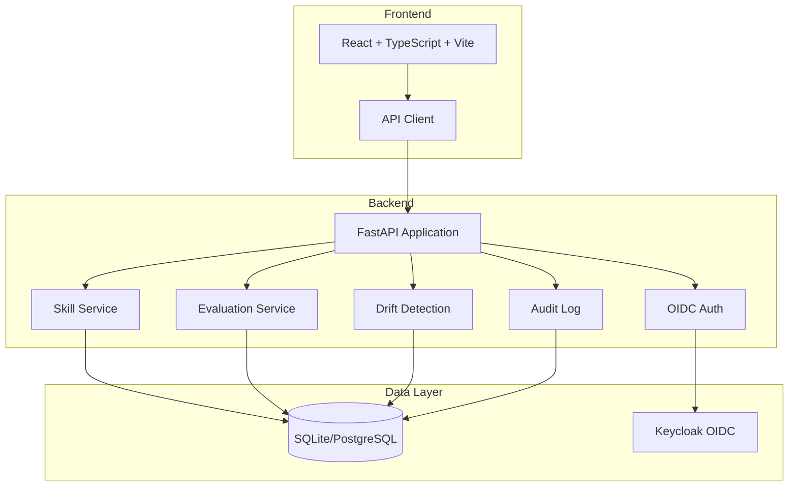

# Signal Console

> Work in progress. This checkpoint may be incomplete or fail tests. See PLAN.md and STATUS.md before use.


Production-grade engineering skills platform for AI coding agents.

## Overview

Signal Console enables evaluation, drift detection, and validation of AI agent skills across model releases. Built for AI/ML developers who need reproducible baselines, statistical confidence intervals, and automated regression detection for agent capabilities.

**Author:** Alan Vo | AI & Machine Learning  
**Contact:** alanvo@gmail.com

## Features

- **Skill Registry**: Manage and version agent skills with JSON schemas
- **Evaluation Runner**: Execute skill evaluations with configurable sample sizes and providers
- **Drift Detection**: Statistical comparison of model performance across releases with confidence intervals
- **Multi-Provider LLM Support**: OpenAI-compatible, Anthropic, Gemini, and Ollama adapters
- **OIDC Authentication**: Keycloak integration with SAML identity broker support
- **Role-Based Access Control**: Admin, Operator, Analyst, and Viewer roles
- **Audit Logging**: Comprehensive audit trail for all actions
- **Demo Mode**: Local development without external dependencies

## Architecture



## Quick Start

### Prerequisites

- Docker and Docker Compose
- Python 3.12+ (for local development)
- Node.js 24+ (for local frontend development)

### Using Docker Compose (Recommended)

```bash
# Clone the repository
git clone https://github.com/ALANDVO/signal-console-144-alan-vo.git
cd signal-console-144-alan-vo

# Copy environment template
cp .env.example .env

# Start all services
docker compose up -d

# Access the application
# Frontend: http://localhost:5173
# Backend API: http://localhost:8000
# Keycloak Admin: http://localhost:8080 (admin/admin)
```

### Local Development

#### Backend

```bash
cd backend
python3 -m venv .venv
source .venv/bin/activate
pip install -r requirements.txt
cp ../.env.example .env
# Edit .env as needed
python -m uvicorn app.main:app --reload --host 127.0.0.1 --port 8000
```

#### Frontend

```bash
cd frontend
npm install
npm run dev
```

## API Reference

### Health Checks

- `GET /api/v1/health` - Basic health check
- `GET /api/v1/health/ready` - Readiness check
- `GET /api/v1/health/live` - Liveness check

### Authentication

- `GET /api/v1/auth/login` - Initiate OIDC login
- `GET /api/v1/auth/callback` - OIDC callback
- `POST /api/v1/auth/logout` - Logout
- `GET /api/v1/auth/me` - Get current user
- `GET /api/v1/auth/demo-login` - Demo login (development only)

### Skills

- `GET /api/v1/skills` - List skills (paginated, filterable)
- `GET /api/v1/skills/{id}` - Get skill by ID
- `GET /api/v1/skills/by-name/{name}` - Get skill by name
- `POST /api/v1/skills` - Create skill (admin/operator)
- `PATCH /api/v1/skills/{id}` - Update skill (admin/operator)
- `DELETE /api/v1/skills/{id}` - Delete skill (admin)

### Evaluations

- `POST /api/v1/skills/{skill_id}/evaluate` - Create evaluation (operator/analyst)
- `GET /api/v1/skills/{skill_id}/evaluations` - List evaluations for skill
- `GET /api/v1/skills/evaluations/{id}` - Get evaluation by ID

### Drift Reports

- `GET /api/v1/drift/reports` - List drift reports (paginated)
- `POST /api/v1/drift/reports` - Create drift report (admin/operator)

### Audit Logs

- `GET /api/v1/drift/audit-logs` - List audit logs (admin/operator)

## Configuration

### Environment Variables

| Variable | Description | Default |
|----------|-------------|---------|
| `APP_NAME` | Application name | `signal-console` |
| `APP_VERSION` | Application version | `1.0.0` |
| `DEBUG` | Enable debug mode | `false` |
| `ENVIRONMENT` | Environment name | `production` |
| `DATABASE_URL` | SQLAlchemy database URL | `sqlite+aiosqlite:///./data/app.db` |
| `OIDC_ISSUER_URL` | Keycloak issuer URL | (required for OIDC) |
| `OIDC_CLIENT_ID` | OIDC client ID | (required for OIDC) |
| `OIDC_CLIENT_SECRET` | OIDC client secret | (required for OIDC) |
| `OIDC_REDIRECT_URI` | OIDC redirect URI | `http://localhost:5173/auth/callback` |
| `SESSION_SECRET_KEY` | Session signing key | (required) |
| `COOKIE_SECURE` | Secure cookies | `false` |
| `COOKIE_SAMESITE` | SameSite policy | `lax` |
| `LLM_API_KEY` | LLM provider API key | (optional) |
| `LLM_PROVIDER` | LLM provider type | `openai-compatible` |
| `LLM_MODEL` | LLM model name | `gpt-4o-mini` |
| `LLM_BASE_URL` | LLM base URL | (optional) |
| `LLM_TIMEOUT` | LLM request timeout | `30.0` |
| `DEMO_MODE` | Enable demo login | `true` |

### LLM Provider Configuration

Supported providers:
- `openai-compatible` - OpenAI, LiteLLM, OpenRouter, Ollama (OpenAI-compatible)
- `anthropic` - Anthropic Messages API
- `gemini` - Google Gemini generateContent API
- `ollama` - Ollama native API

## Security

### Authentication Flow

1. User initiates login via `/auth/login`
2. Redirected to Keycloak for authentication
3. Keycloak redirects back to `/auth/callback` with authorization code
4. Backend exchanges code for tokens, validates ID token (nonce, signature, issuer, audience)
5. Creates session JWT stored in HttpOnly, SameSite cookie
6. Subsequent requests include cookie automatically

### Authorization

- **Viewer**: Read-only access to skills, evaluations, drift reports
- **Analyst**: Viewer + create evaluations
- **Operator**: Analyst + create/update skills, create drift reports
- **Admin**: Full access including user management and audit logs

### Production Requirements

- Set `COOKIE_SECURE=true` behind TLS
- Use strong `SESSION_SECRET_KEY` (32+ random characters)
- Configure `OIDC_ISSUER_URL` to production Keycloak
- Disable `DEMO_MODE=false`
- Use reverse proxy with TLS termination (nginx, Traefik, Caddy)
- Regular database backups

## Testing

### Backend Tests

```bash
cd backend
PYTHONPATH=. .venv/bin/pytest -v
```

### Frontend Tests

```bash
cd frontend
npm test
```

### Full Test Suite (CI)

```bash
# Backend
PYTHONPATH=backend .venv/bin/pytest backend/tests -v --cov=app

# Frontend
cd frontend && npm run build && npm test
```

## Deployment

### Docker Production Build

```bash
# Build images
docker compose build

# Run with production config
ENVIRONMENT=production COOKIE_SECURE=true DEMO_MODE=false docker compose up -d
```

### Reverse Proxy (nginx example)

```nginx
server {
    listen 443 ssl http2;
    server_name your-domain.com;

    ssl_certificate /path/to/cert.pem;
    ssl_certificate_key /path/to/key.pem;

    location / {
        proxy_pass http://127.0.0.1:5173;
        proxy_set_header Host $host;
        proxy_set_header X-Real-IP $remote_addr;
        proxy_set_header X-Forwarded-For $proxy_add_x_forwarded_for;
        proxy_set_header X-Forwarded-Proto $scheme;
    }

    location /api/ {
        proxy_pass http://127.0.0.1:8000;
        proxy_set_header Host $host;
        proxy_set_header X-Real-IP $remote_addr;
        proxy_set_header X-Forwarded-For $proxy_add_x_forwarded_for;
        proxy_set_header X-Forwarded-Proto $scheme;
    }

    location /auth/ {
        proxy_pass http://127.0.0.1:8000;
        proxy_set_header Host $host;
        proxy_set_header X-Real-IP $remote_addr;
        proxy_set_header X-Forwarded-For $proxy_add_x_forwarded_for;
        proxy_set_header X-Forwarded-Proto $scheme;
    }
}
```

### Backup & Restore

```bash
# Backup database
docker compose exec backend cp /app/data/app.db /app/data/app.db.backup.$(date +%Y%m%d)

# Restore database
docker compose exec backend cp /app/data/app.db.backup.20240101 /app/data/app.db
```

## AI/ML Evaluation

Signal Console implements a substantive domain engine for AI agent skill evaluation:

### Reproducible Baselines

Each skill evaluation runs with:
- Configurable sample size (default 5, up to 100)
- Fixed model version and provider
- Deterministic prompts and evaluation criteria
- Confidence intervals (95% default)

### Drift Detection

Compares model versions using:
- Effect size calculation (Cohen's d)
- Statistical significance testing (p-value)
- Configurable confidence levels
- Regression flagging when effect exceeds threshold

### Evaluation Methodology

Based on research from:
- Driftproof (driftproofhq.com) - skill evaluation across model releases
- SWE-Bench-CL - longitudinal coding agent evaluation
- A-MAC - explicit memory admission for agent skills

### Running Evaluations

```bash
# Create a skill
curl -X POST http://localhost:8000/api/v1/skills \
  -H "Content-Type: application/json" \
  -d '{"name":"code-review","display_name":"Code Review","description":"Reviews code quality","category":"quality","schema":"{}"}'

# Run evaluation
curl -X POST http://localhost:8000/api/v1/skills/1/evaluate \
  -H "Content-Type: application/json" \
  -d '{"skill_id":1,"model_name":"gpt-4o","model_version":"2024-08-06","provider":"openai-compatible","sample_size":5}'
```

## License

MIT License

Copyright (c) 2024 Alan Vo <alanvo@gmail.com>

Permission is hereby granted, free of charge, to any person obtaining a copy
of this software and associated documentation files (the "Software"), to deal
in the Software without restriction, including without limitation the rights
to use, copy, modify, merge, publish, distribute, sublicense, and/or sell
copies of the Software, and to permit persons to whom the Software is
furnished to do so, subject to the following conditions:

The above copyright notice and this permission notice shall be included in all
copies or substantial portions of the Software.

THE SOFTWARE IS PROVIDED "AS IS", WITHOUT WARRANTY OF ANY KIND, EXPRESS OR
IMPLIED, INCLUDING BUT NOT LIMITED TO THE WARRANTIES OF MERCHANTABILITY,
FITNESS FOR A PARTICULAR PURPOSE AND NONINFRINGEMENT. IN NO EVENT SHALL THE
AUTHORS OR COPYRIGHT HOLDERS BE LIABLE FOR ANY CLAIM, DAMAGES OR OTHER
LIABILITY, WHETHER IN AN ACTION OF CONTRACT, TORT OR OTHERWISE, ARISING FROM,
OUT OF OR IN CONNECTION WITH THE SOFTWARE OR THE USE OR OTHER DEALINGS IN THE
SOFTWARE.